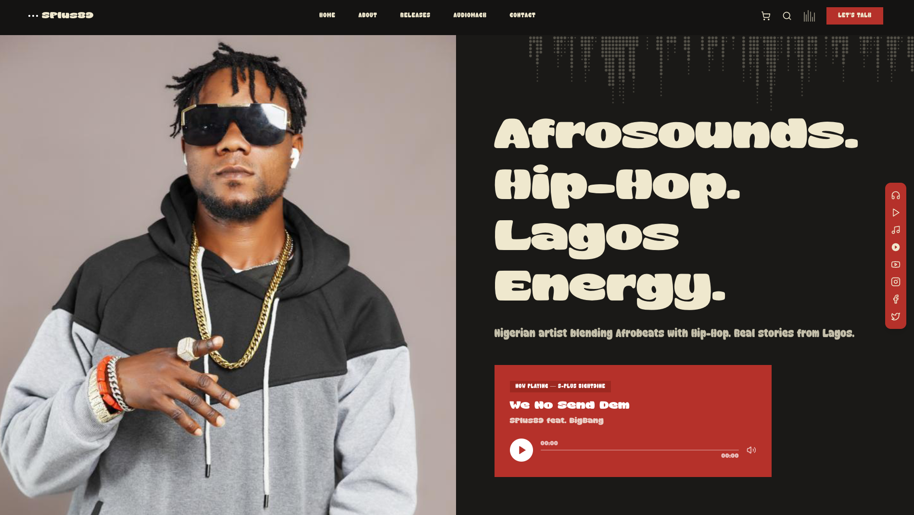

# SPlus89 - Official Artist Website



## 🎤 About SPlus89

**SPlus89** is a dynamic hip-hop and pop fusion artist, blending powerful beats with soulful melodies to create a unique sound that resonates with audiences worldwide. Known for electrifying performances and genre-defying music, SPlus89 continues to push the boundaries of modern hip-hop.

## 🌐 Live Website

**[Visit SPlus89.com](https://splus89.vercel.app)**

## ✨ Features

- 🎵 **Music Releases** - Explore the latest albums, singles, and tracks
- 📅 **Upcoming Events** - Stay updated on live performances and tours
- 📸 **Visual Gallery** - Behind-the-scenes content and professional photography
- 📬 **Contact** - Connect with SPlus89 for bookings and collaborations

## 🛠️ Tech Stack

- **Framework:** Next.js 15
- **Styling:** Tailwind CSS
- **UI Components:** Radix UI / shadcn/ui
- **Animations:** Custom CSS animations
- **Deployment:** Vercel

## 🚀 Getting Started

```bash
# Clone the repository
git clone https://github.com/stynerdev225/SPlus89.git

# Navigate to the project
cd SPlus89

# Install dependencies
pnpm install

# Run development server
pnpm dev
```

Open [http://localhost:3000](http://localhost:3000) to view the site locally.

## 📂 Project Structure

```
SPlus89/
├── app/              # Next.js App Router pages
├── components/       # Reusable UI components
├── public/           # Static assets (images, videos, fonts)
├── styles/           # Global styles
├── hooks/            # Custom React hooks
└── lib/              # Utility functions
```

## 👨‍💻 Developer

Built with ❤️ by [StynerDev](https://www.styner.dev/)

## 📄 License

© 2026 SPlus89. All rights reserved.
